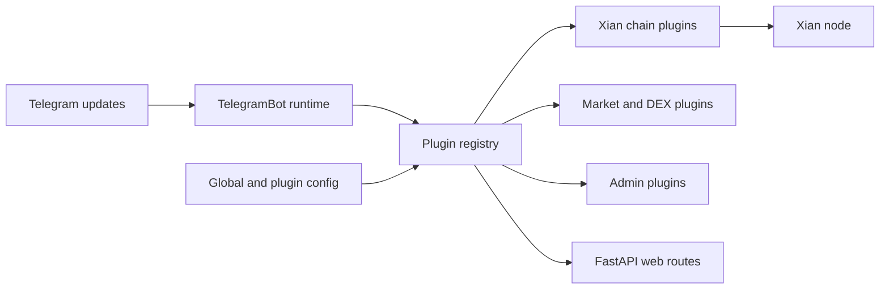

# xian-tg-bot

`xian-tg-bot` is a plugin-first Telegram bot framework for Xian. It wraps
[`python-telegram-bot`](https://github.com/python-telegram-bot/python-telegram-bot)
with async-first plugin discovery, an embedded FastAPI HTTP layer, SQLite
persistence helpers, and a manifest-driven configuration system, then
ships a sizable set of Xian-specific plugins (balances, transfers, prices,
DEX trades, charts, lotteries, admin, …) as ready-to-run features.

## Runtime Shape



## Quick Start

```bash
git clone https://github.com/xian-technology/xian-contracting.git
git clone https://github.com/xian-technology/xian-py.git
git clone https://github.com/xian-technology/xian-tg-bot.git
cd xian-tg-bot
uv sync
```

Keep these repositories as siblings: the bot uses the current SDK, account,
and runtime type packages from those checkouts. It requires `xian-tech-py`
0.5.x and Python 3.14.

Create a `.env`:

```env
TG_TOKEN=your_bot_token
LOG_LEVEL=INFO        # DEBUG, INFO, WARNING, ERROR
LOG_INTO_FILE=true
```

Run the bot:

```bash
uv run python run_bot.py
```

For a PM2-managed production profile:

```bash
chmod +x start.sh
pm2 start pm2.config.json
tail -F log/bot.log
pm2 restart tg-bot
pm2 save && pm2 startup     # persist across reboots
```

## Principles

- **Plugins are units of feature.** Every command, handler, web route, and
  scheduled job lives inside an isolated plugin under `plg/`. The
  framework wires them up.
- **Async-first.** Handlers, jobs, and storage are async (`asyncio` +
  `aiosqlite`). The framework expects coroutine-based plugin code.
- **Pluggable HTTP layer.** Plugins can expose FastAPI routes through
  `WebAppWrapper`, so the same process serves Telegram and HTTP traffic.
- **Manifest-driven config.** Global defaults live in `cfg/global.json`;
  per-plugin overrides live in `cfg/<plugin>.json`. Secrets stay in
  environment variables.
- **Operational tooling baked in.** Structured logging via `loguru`,
  graceful shutdown, and PM2-ready scripts.

## Key Directories

- `main.py` — `TelegramBot` runtime and lifecycle.
- `run_bot.py`, `logging_setup.py` — safe startup diagnostics and bounded operational logs.
- `plugin.py` — `TGBFPlugin` base class, manifest utilities, decorators.
- `web.py` — FastAPI wrapper that plugins extend.
- `plg/` — feature plugins. Each plugin lives under `plg/<feature>/` and
  contains handlers, optional web endpoints, and per-plugin resources.
  Bundled plugins include:
  - **Wallet / chain** — `balance`, `address`, `send`, `tip`, `rain`,
    `simulate`, `submit`, `approve`, `event`, `tokens`, `tokenomics`.
  - **Markets / DEX** — `price`, `chart`, `trend`, `buy`, `sell`,
    `cex`, `buybot`.
  - **Network / data** — `active`, `api`, `testnet`, `backup`, `update`.
  - **Operator / admin** — `admin`, `manage`, `shutdown`, `logfile`,
    `debug`, `error`, `feedback`.
  - **Community / fun** — `lottery`, `bless`, `start`, `help`, `about`,
    `all`.
- `cfg/` — global defaults (`global.json`) and plugin configs.
- `res/` — shared static assets.
- `tests/` — async `pytest` suite (with `pytest-asyncio`).
- `pm2.config.json`, `start.sh` — production process management.

## Configuration

Global settings (`cfg/global.json`):

```json
{
  "admin_tg_id": 123456789,
  "webserver_host": "0.0.0.0",
  "webserver_port": 5000,
  "xian": {
    "node": "http://127.0.0.1:26657",
    "explorer": "http://127.0.0.1:8080",
    "chain_id": "your-chain-id"
  }
}
```

`webserver_host` defaults to `0.0.0.0`; set it to an IPv6 bind host such as
`::` or `::1` when needed.

Each plugin may provide `cfg/<plugin>.json` with keys such as `handle`,
`requires`, `description`, `category`, `aliases`, `blacklist`, and
`whitelist`.

## Plugin Development

- Place handlers in `plg/<feature>/<feature>.py` with a class that inherits
  `TGBFPlugin`.
- Define an optional `MANIFEST` attribute or rely on
  `PluginManifest.materialize` for default registration.
- Register jobs, handlers, and web routes through the helper methods on
  `TGBFPlugin`.
- Add tests under `tests/` mirroring the plugin module; stub external
  services where needed.

See `plg/README.md` for detailed patterns and `AGENTS.md` for contributor
expectations.

## Validation

```bash
uv run pytest                # async test suite
uv run ruff check .          # lint
uv run mypy                  # configured type-check scope
uv run python scripts/tx_smoke.py --rpc-url http://127.0.0.1:26657 --chain-id xian-localnet-1 --private-key "$FUNDED_LOCAL_PRIVATE_KEY"
uv run python run_bot.py        # launch with current config
```

Transaction commands read typed SDK submissions and confirm execution by
transaction hash before reporting success. Confirmation timeout messages retain
the hash because an accepted transaction may still complete. The bot shares an
HTTP session across SDK clients and closes it during shutdown. Chart image
rendering with Kaleido 1.x requires Chrome; install it with
`uv run plotly_get_chrome` before enabling chart commands.

## Operational logs

Run `uv sync` before starting the PM2 profile: `start.sh` uses the existing
`.venv/bin/python` to run `run_bot.py`. The entrypoint configures logging before
loading the bot and captures failed imports and fatal runtime exceptions with an
incident ID, exception type, and bounded frame locations. It does not record
exception payloads, source lines or local variables. A missing Python interpreter
cannot produce an application log; inspect `pm2 describe tg-bot` for failed
process starts and rerun `uv sync`.

Lines use `UTC timestamp | LEVEL | tg-bot/component | message | context`.
`log/bot.log` is the current file. The single bot process rotates **hourly or at
50 MiB**, keeps at most **250 MiB** of its owned files, and expires segments by
the oldest record's age after **7 days**. A restart recovers active segment age
from its first timestamp instead of refreshing old records' retention. Cleanup
runs at startup, rotation, and every 60 seconds while idle; normal writes use
cached size/time metadata without directory scans. One complete active-file
allowance is reserved inside the total budget, so archives use at most 200 MiB.
Size retention may shorten history below seven days.

Only `bot.log`, `bot.<digits>.log`, and legacy Loguru timestamp names such as
`2026-11-03_12-30-00_123456.log` belong to this policy. Other files are left alone.
Existing oversized or expired owned legacy files are removed on startup. Keep
this directory dedicated to one bot process. Records are single-line, escape
Unicode control/format characters, and are bounded to 16 KiB in files; oversized
records carry a truncation marker. Integer context is bounded before formatting.
New log directories and files use owner-only permissions.

The supplied PM2 profile forces application file logging and discards duplicate
PM2 stdout/stderr files, so use `tail -F log/bot.log` instead of `pm2 logs` for
application diagnostics. Standalone runs also emit to stderr. PM2's own supervisor
log is managed separately by the host and is **not bounded by this application**.
The host owner must apply a separate retention policy to that daemon log.
Use the inspectable [dedicated-account logrotate template and deployment
instructions](deploy/README.md): seven-day maximum archive age, 50 MiB rotation
threshold and four retained archives, with scheduled checks while idle. This is
not a hard quota between scheduled checks. No host changes or global PM2 module
installation are performed by starting the bot. Historical PM2 application files
are not deleted automatically; archive or remove them after stopping the old profile.

Database diagnostics include only the statement type and argument count, never
SQL text or values. Update and error diagnostics use handler/update and incident
IDs rather than message text, chat/user state or wallet material. Admin error
notifications use the same safe metadata. Third-party service logs preserve the
component, level, HTTP method/status where available, and exception type/frame
locations; request URLs and bodies are never forwarded. Bundled plugin exception
logs and transaction diagnostics use the same safe metadata, including at
`LOG_LEVEL=DEBUG`. Do not add private keys, tokens or user message bodies
to plugin log messages or context fields.

## Updating

```bash
pm2 stop tg-bot
git pull origin main
uv sync
pm2 restart tg-bot
```

Review release notes for configuration or schema changes, and run the test
suite before restarting.

## Requirements

- Python 3.14
- uv
- Telegram bot token in `.env`
- Optional: PM2 for production process management
  (`npm install -g pm2`)

## Related Docs

- [plg/README.md](plg/README.md) — plugin development patterns
- `AGENTS.md` — contributor expectations
- [`python-telegram-bot`](https://github.com/python-telegram-bot/python-telegram-bot) — underlying Telegram client
